# Frankie's walk: M-20261011-001, Item Commits and Git Conventions (re-walk)

**PRD:** `prd/ready/item-commits.md` (118 lines, read in full)
**Contract:** the mission's stored contract (`profile: deep`, `review_tier: hands-on`, `testing_level: full-dod`) resolved with `resolveExecutionContract`. Repo facts from `ateam.config.json`: surfaces `cli`, `web`; `qa.drive: flowspec`; `devServer` `http://localhost:5567`, `managed: true`; evidence `screenshots` (no video).
**Date:** 2026-10-31
**Verdict: 13 of 16 pass, 0 fail. Not drivable by Frankie: 4 (whole), 12 (whole), 16 (Tawnia half).**

No failures. The item-commit core (statements 1 to 3, 5, 6, 8 to 11) was driven end to end in the sandbox with real file changes and passes.

## Not drivable by Frankie (for the operator to verify)

- **4 (rework after `staged`).** A reworked item must be moved out of `staged`, and only Hannibal's board move does that. Frankie's session blocks the command, and team-lead declined to run it on Frankie's behalf. The parts that can be shown pass: a new commit for the same item updates the SHA recorded on the item (WI-002: `null`, then `4fad943` after the retry, statement 10), and item commits are never amended (statement 1's log). See O1 for what "on the board" can mean.
- **12 (Tawnia's commit) and the Tawnia half of 16.** Tawnia runs after Frankie. The static check of `agents/tawnia.md` matches both statements (evidence under 12 and 16).

## Checklist

| # | DoD statement (short) | Result |
|---|---|---|
| 1 | One commit per staged item, attributed paths only, `Item`/`Mission`/`PRD`/`Lanes` trailers, no `Co-authored-by` | ✅ PASS |
| 2 | Subject is type prefix + exact board title | ✅ PASS (`feat` only: all fixtures are `feature`) |
| 3 | Reworked item shows lanes in order with repeats | ✅ PASS |
| 4 | Rework makes a new commit, old commit unchanged, board shows latest SHA | NOT DRIVABLE by Frankie (operator) |
| 5 | Pre-mission dirty files and other unstaged items' files never in an item commit | ✅ PASS |
| 6 | Undeclared changed file goes to the next staged item and is listed in its body | ✅ PASS |
| 7 | No-change item makes no commit; work log says why | ✅ PASS |
| 8 | Two items staged at once both commit (no index-lock failure) | ✅ PASS |
| 9 | Wrong branch: no commit, `ITEM_COMMIT_FAILED` on stderr telling the agent to ALERT Hannibal, `itemCommit.committed: false`, activity feed on :5567 shows it | ✅ PASS |
| 10 | Operator can retry the commit with one CLI command, item stays in `staged` | ✅ PASS |
| 11 | Native and legacy paths both commit; legacy playbook runs `ateam pool init` at start | ✅ PASS |
| 12 | Tawnia's commit: docs, evidence, `specs/<prd-slug>/`, leftovers by path, no item code, ends with `Mission:`/`PRD:` | NOT DRIVABLE at walk time. Static check matches |
| 13 | `missions-pr openDraft` pushes and calls stub `gh pr create --draft --body-file`, never `ready`/`merge`; no remote / failing `gh auth` / `pullRequest.open: false` open nothing and print path + command | ✅ PASS (all four cases) |
| 14 | Sandbox squash with generated description + two appended `Co-authored-by` lines keeps `Mission:`/`PRD:` in `git interpret-trailers --parse` | ✅ PASS (sandbox). The real GitHub squash is the operator's check |
| 15 | Operator docs name "Default commit message: Pull request title and description" | ✅ PASS |
| 16 | A pre-mission dirty file later changed by the mission is in no commit; Tawnia's body and DONE list it | ✅ PASS (item half) / NOT DRIVABLE (Tawnia half). Static check matches |

## Observations (not DoD statements, not counted)

- **O1. The board UI never shows an item's commit SHA.** `GET /api/items/<id>` returns `commitSha` (all five sandbox items have theirs), but no UI component renders it, and the item dialog has no commit field (see the WI-003 dialog screenshot). WI-330's acceptance criteria are API-only, so this is not a WI-330 defect. If statement 4's "the item on the board shows the latest SHA" means the web UI, the operator's check of statement 4 will fail. A human should decide which meaning the DoD intends.
- **O2. The sandbox script does not seed a pre-mission dirty file (WI-343 fixture gap).** It runs `ateam pool init` on a clean tree, so `baseline-dirty` is empty. To walk statements 5 and 16, Frankie made two files dirty (`README.md` modified, `notes/preexisting.txt` untracked), then ran `ateam pool destroy --all` and `ateam pool init --single-use` before driving any item. `pool init` is the step that records the baseline at a real mission start. Only the script's own WI-001 legacy commit came before it. The script should seed the dirty file before its own `pool init`, so a walk needs no re-init.
- **O3. A failed item commit leaves the item's files exposed to the next staging item (code reading, not driven).** `Attribute` blocks only outputs of items not yet in `staged`. An item whose commit failed is already in `staged`, so if another item stages before the operator retries, the failed item's declared files would go into that other commit as "undeclared". The walk retried WI-002 immediately, so this did not occur. The recovery docs could tell the operator to retry before more items stage.
- **O4. A second `commitItem` with nothing left adds another "no changes to commit" work-log note**, even though the item already has a commit and a SHA. The help text says it records the newest matching SHA in that case, and it returned `noChanges` without an error. This is a cosmetic issue in the work log.
- **O5. Last walk's findings are fixed.** `agents/tawnia.md` writes `PRD: <prd-slug>` (WI-338). `missions-pr describe` has a summary line, and `--json` returns `{path, title}` (WI-336). `docs/ORCHESTRATION.md` credits the squash trailers to the PR description and adds the operator `--parse` check (WI-342).
- **O6. Co-author placement probes (not DoD).** With the co-author lines as a separate paragraph (variant b) or after a `---------` line (variant c), `--parse` returns only the `Co-authored-by` lines. `docs/ORCHESTRATION.md` line 239 names this case and the operator check.

## Evidence

### Step 0: pre-mission dirty files recorded (setup for 5 and 16)

`README.md` modified and `notes/preexisting.txt` created, then `pool destroy --all` + `pool init --single-use`. `baseline-dirty` now lists both; `branch` is `mission/sandbox`. See O2.

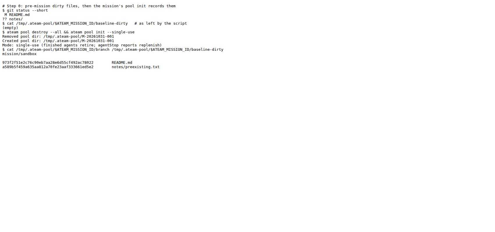

### 1, 2, 3, 5, 6, 11 (native): WI-003 through every lane, with a rework ✅

WI-003 "Sandbox counter" went murdock-1, ba-1, lynch-1 (REJECTED, `--return-to implementing`), ba-1, lynch-2, amy-2, writing its declared test and impl along the way. Just before amy-2's `agentStop`, the tree also held `src/index.js` (declared by no item), `src/parser.js` (declared by WI-004, still in `ready`), a second edit to the baseline file `README.md`, and the baseline file `notes/preexisting.txt`.

Result: `itemCommit: {committed: true, sha: 0430a23…}`. Commit `0430a23`:
- subject `feat: Sandbox counter` (type `feature`, board title `Sandbox counter`)
- files: `src/__tests__/counter.test.js`, `src/counter.js`, `src/index.js`
- body: `Undeclared paths included: - src/index.js`
- trailers: `Item: WI-003`, `Mission: M-20261031-001`, `PRD: item-commits`, `Lanes: murdock-1 ba-1 lynch-1 ba-1 lynch-2 amy-2`
- no `Co-authored-by`

Left uncommitted: `README.md`, `notes/`, `src/parser.js`. Board: WI-003 `commitSha` `0430a23…`, rejection count 1.

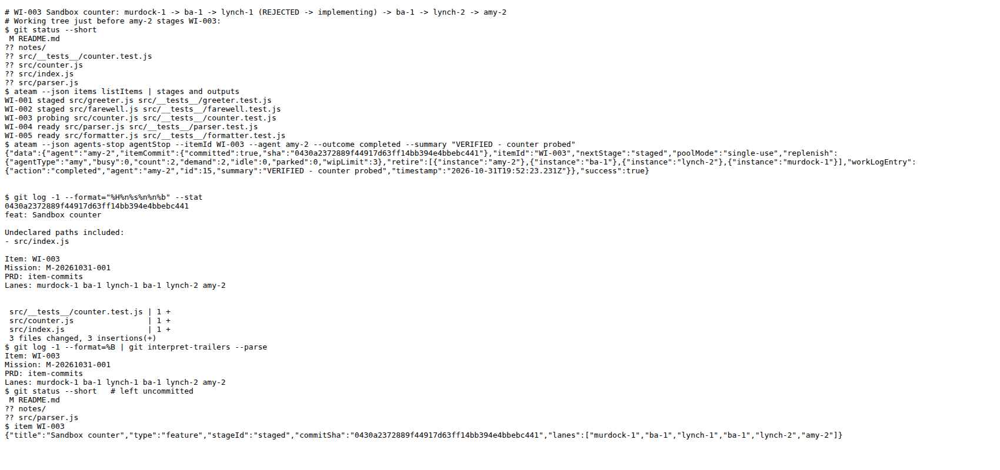
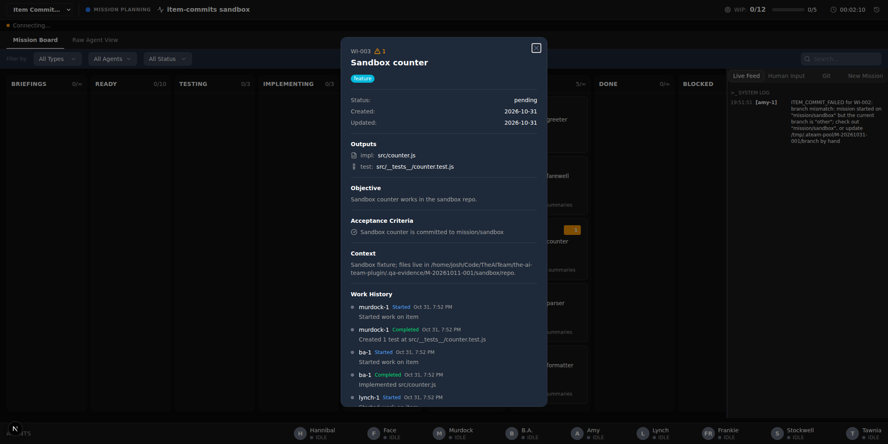

### 1, 5, 16 (item half): the whole mission branch ✅

After all five items reached `staged` there were five item commits, one per item: `ad87429` WI-001 (legacy), `4fad943` WI-002, `0430a23` WI-003, `3e877bd` WI-004, `9c807c0` WI-005, plus the initial commit. Each holds only its item's paths, plus `src/index.js` in WI-003's commit. The driven items carry `Lanes:`; WI-001, moved directly by the script, has no lane history and no `Lanes:` (by design). None of the six commits has a `Co-authored-by` line. `git log --all -- README.md notes/preexisting.txt` shows only the initial commit, and `README.md` still holds both the pre-mission and the mission edits, uncommitted.

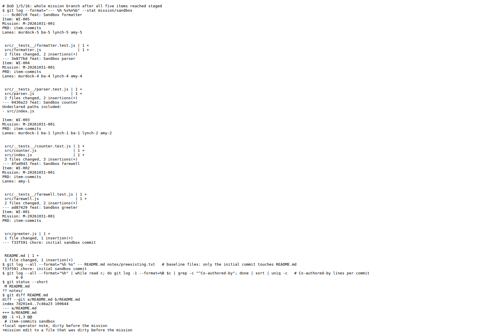

### 7. No-change item makes no commit ✅

Walked in the first sandbox run of this walk (before team-lead approved file fixtures): WI-002 went from `probing` to `staged` through amy-1's `agentStop` with no file changes. JSON `itemCommit: {committed: false, noChanges: true}`, `git log` unchanged, and the board's work history shows "no changes to commit: no attributed paths for this item".

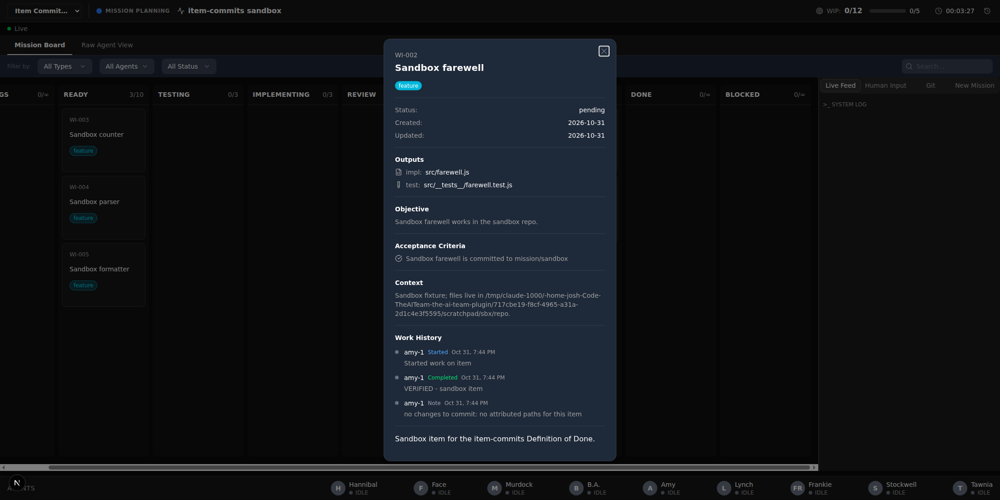
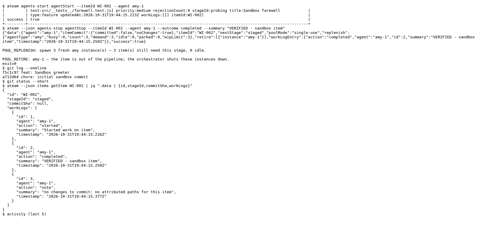

### 8. Two items staged at once ✅

WI-004 and WI-005 were driven to `probing` with their files written. Then amy-4's and amy-5's `agentStop` ran in parallel (`&` + `wait`, both started at 19:52:36.06 and finished by 19:52:36.54). Both returned `committed: true`: `3e877bd` (WI-004, parser files only) and `9c807c0` (WI-005, formatter files only). No index-lock error and no leftover `.git/index.lock`. Each commit has its own `Lanes:`, and the board records both SHAs.

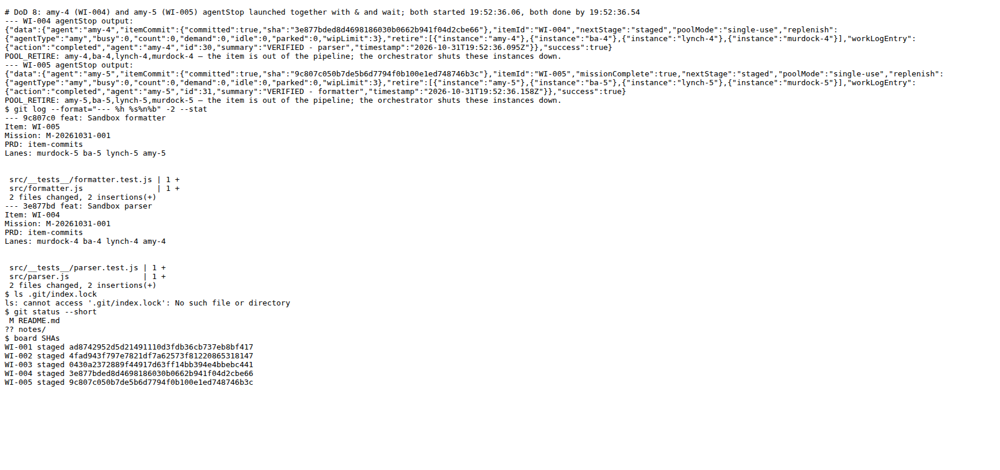

### 9. Wrong branch ✅

WI-002 had its declared files written. After `git switch -c other`, amy-1's `agentStop` moved it to `staged`. Stderr: `ITEM_COMMIT_FAILED: WI-002: branch mismatch: mission started on "mission/sandbox" but the current branch is "other"; … — send ALERT to Hannibal; the item stays in staged.` JSON: `itemCommit: {committed: false, error: "branch mismatch …"}`. No new commit on any branch, and `commitSha` stays `null`. The :5567 Live Feed shows the error entry from amy-1.

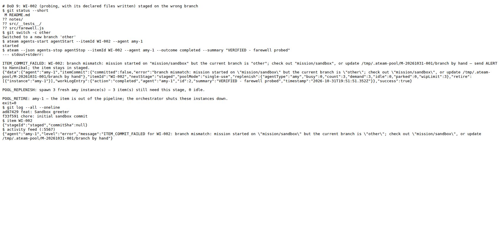
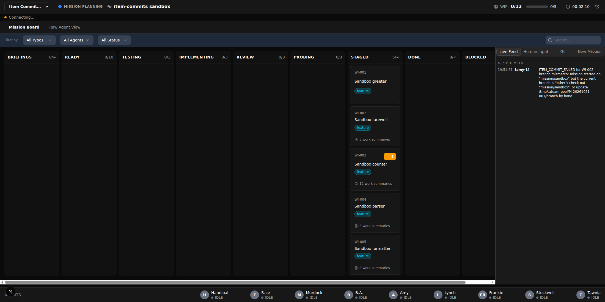

### 10. Retry with one command ✅

`git switch mission/sandbox`, then `ateam --json items-commit commitItem --itemId WI-002` gives `{"committed":true,"sha":"4fad943…"}`. WI-002 stays in `staged` with `commitSha` `4fad943…`. The commit holds only `src/farewell.js` and its test, with trailers including `Lanes: amy-1`. A second run returns `noChanges` (O4). On a `ready` item it refuses: `only items in "staged" can be committed`.

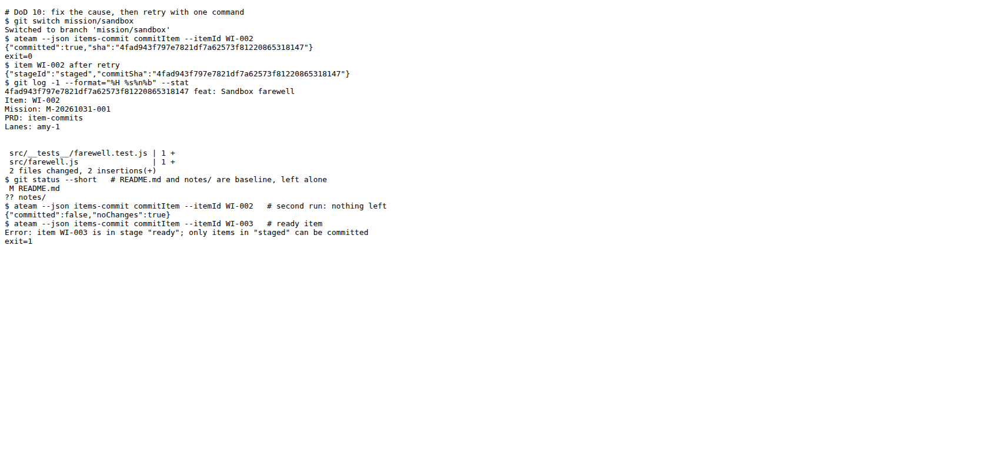

### 11. Legacy path and playbook ✅

The sandbox script moved WI-001 `probing` to `staged` with the legacy moveItem command, using the branch CLI. That produced item commit `ad87429` (`feat: Sandbox greeter`, `src/greeter.js` only, `Item`/`Mission`/`PRD` trailers) and recorded the SHA on WI-001. The native path is WI-002 to WI-005 above. `playbooks/orchestration-legacy.md` "Mission Start: Record the Branch" runs plain `ateam pool init` after the precheck and before the first dispatch.

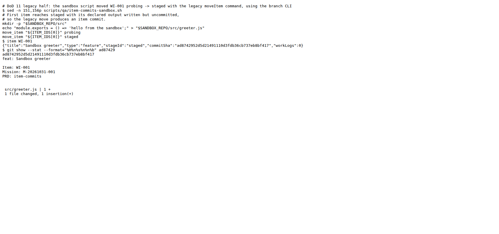
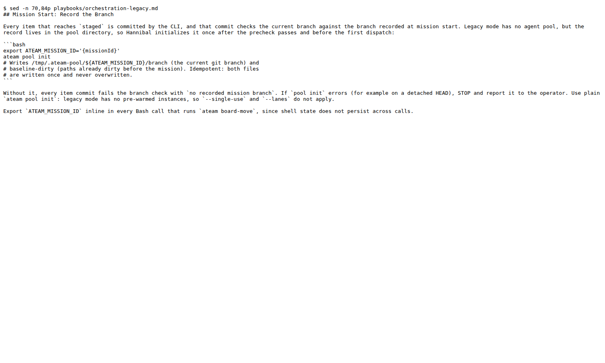

### 12 and 16 (Tawnia halves): static check of `agents/tawnia.md`

Step 6 and "Commit Format" match both statements:
- Tawnia stages by path only: docs, Frankie's evidence, new `specs/<prd-slug>/` files, and listed leftovers.
- Item code and `baseline-dirty` paths are never staged.
- The commit body lists leftover unattributed paths and "pre-existing files changed by the mission, not committed". The DONE message repeats the latter.
- The commit ends with `Mission: <missionId>` and `PRD: <prd-slug>`, in the same paragraph as the `Co-authored-by` lines.

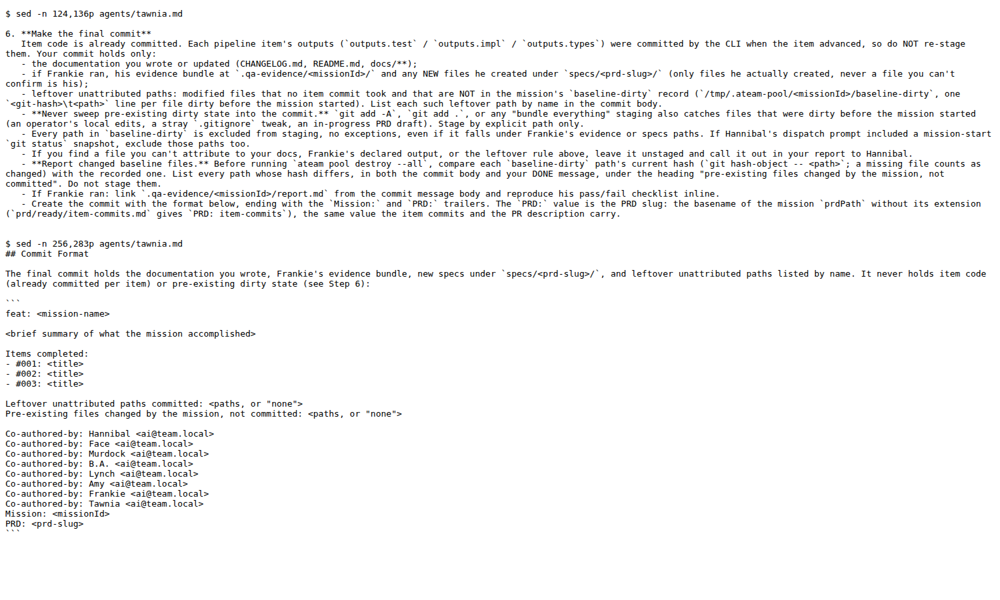

### 13. `missions-pr openDraft` ✅

- `describe --json` returns `{path, title}`. The file holds the title, a summary line, all five items with their SHAs, the Frankie section, and `Mission:`/`PRD:` last.
- Happy path: bare remote moved `f33f591` to `9c807c0`. Stub calls: `auth status`, `pr view …`, `pr create --draft --title item-commits sandbox --head mission/sandbox --body-file <path>`.
- `GH_STUB_AUTH=fail`, with local HEAD `a8279e3` (an empty operator commit) ahead of the remote: only `auth status` was called, the remote stayed at `9c807c0`, and the command printed the reason, the description path and the exact `gh pr create` command, exit 0.
- No remote: `gh` was never called, same printout, exit 0.
- `pullRequest.open: false` in the sandbox repo's `ateam.config.json`: `gh` was never called, no push, same printout, exit 0.
- Across every run the stub log has no `pr ready` or `pr merge` call.

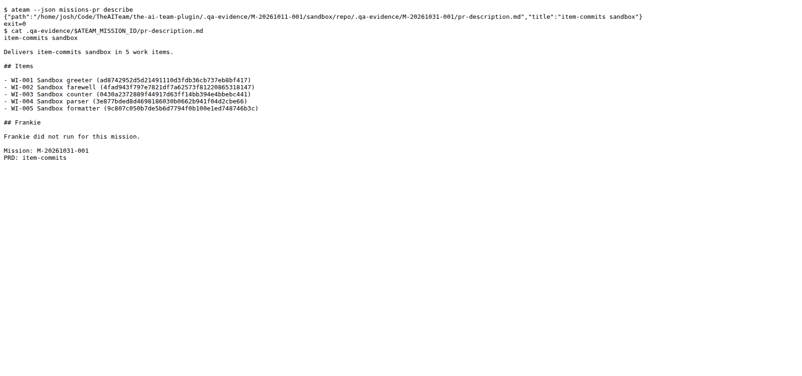
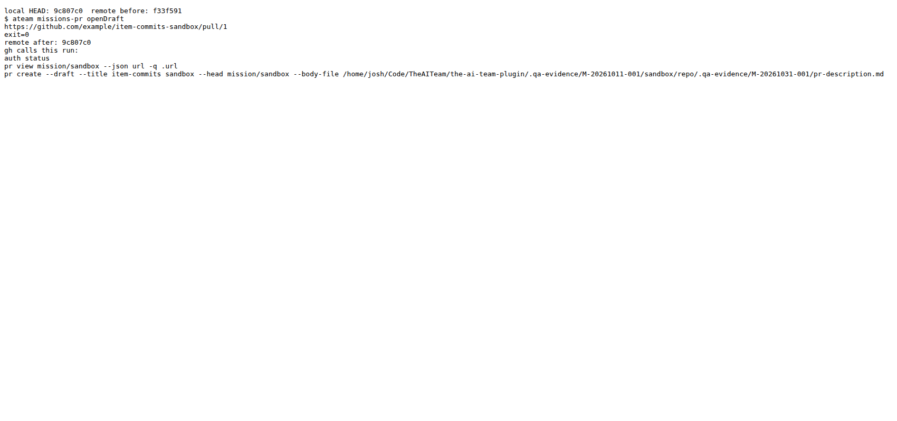
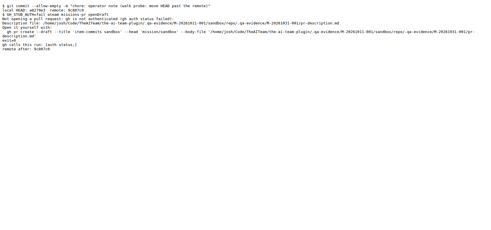
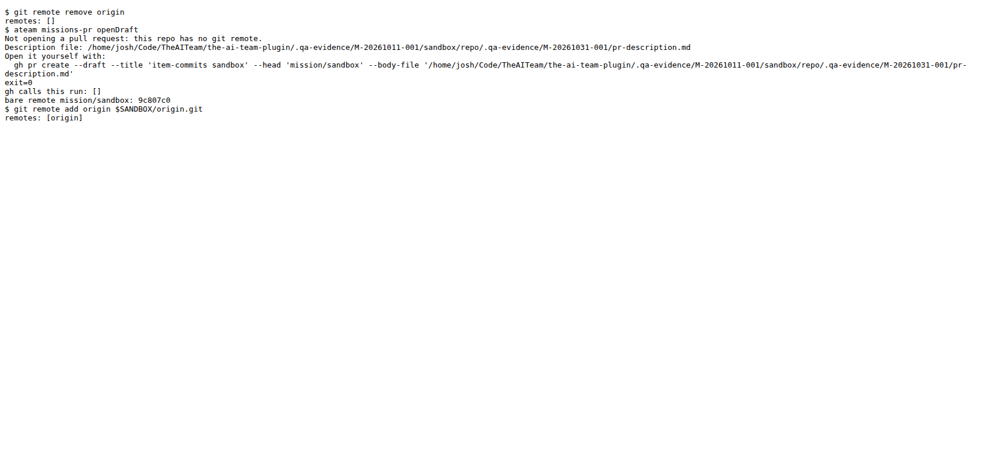
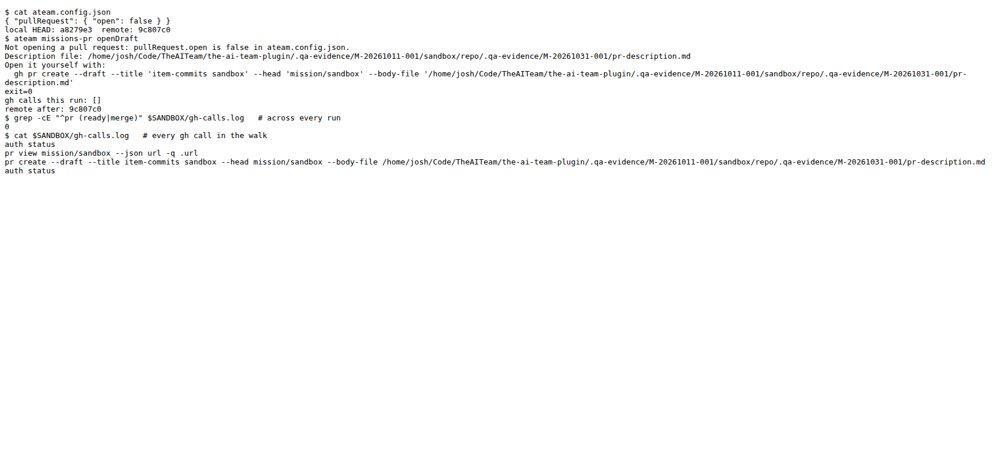

### 14. Sandbox squash keeps trailers ✅

A sandbox `main` was set to the initial commit `f33f591`. `git commit-tree 'mission/sandbox^{tree}' -p main -F rewalk/s14-squash-msg-a.txt` made squash commit `a222533`, with the same tree as `mission/sandbox`. Its message is the generated `pr-description.md` with two `Co-authored-by:` lines appended directly under `PRD:`. `git interpret-trailers --parse` returns `Mission: M-20261031-001`, `PRD: item-commits` and both co-author lines. See O6 for the other placements.

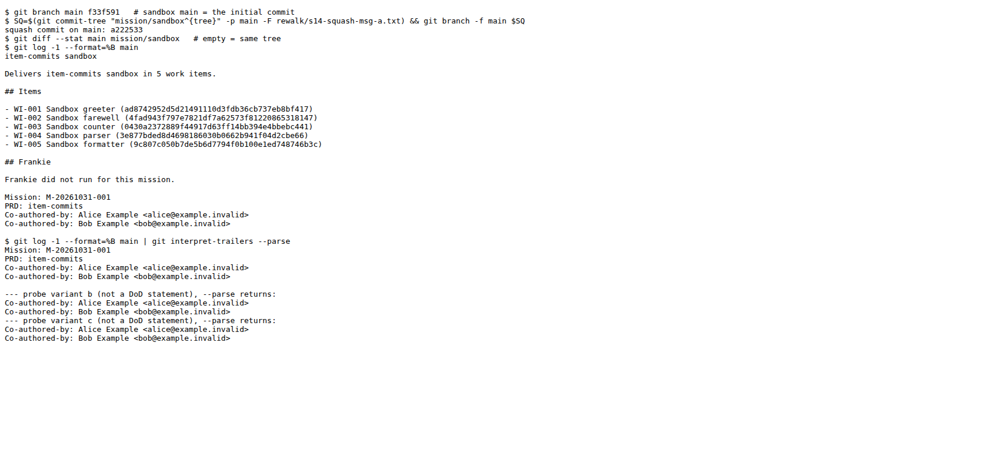

### 15. Operator docs name the GitHub setting ✅

`docs/ORCHESTRATION.md` line 235: Settings, General, Pull Requests, "Default commit message" set to **Pull request title and description**.

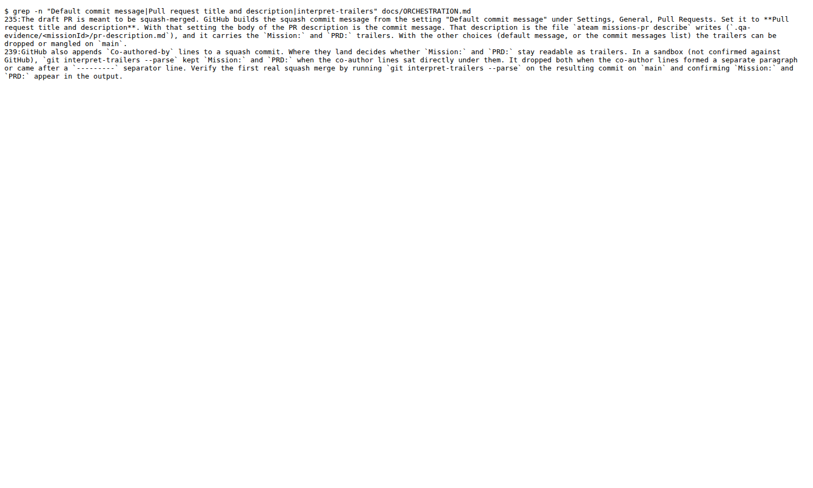

## Environment notes

- QA API: `npm run dev:qa`, started by Frankie (`managed: true`) from a fresh `packages/kanban-viewer/prisma/data/qa.db`. All 22 migrations applied, including `20261011150000_item_commit_sha` (`Item.commitSha` present). Nothing in the walk pointed at :5566 or `ateam.db` (only the real mission's contract read and Frankie's activity entries). Server log: `logs/devqa.log`. Stopped after the walk; :5567 is free.
- Sandbox, first run: in Frankie's scratchpad. Used for statement 7 before the write guard blocked file fixtures there.
- Sandbox, second run (team-lead approved, walk only): `SANDBOX=.qa-evidence/M-20261011-001/sandbox`, built by the script with this branch's CLI. Every sandbox command ran through `logs/walk-env.sh`: `ATEAM_*` cleared, then only the sandbox's exports (`logs/sandbox-env.sh`), plus `GIT_CONFIG_GLOBAL=/dev/null GIT_CONFIG_NOSYSTEM=1`. Mission `M-20261031-001`, project `item-commits-sandbox`, items WI-001 to WI-005, all `staged` at the end.
- Cleanup: the sandbox mission's pool dir was removed with `ateam pool destroy --all`. `.qa-evidence/M-20261011-001/sandbox/` (with its nested `.git`) was deleted, and `ls` confirms it is gone. The first run's scratchpad sandbox, `/tmp/claude-1000/-home-josh-Code-TheAITeam-the-ai-team-plugin/717cbe19-f8cf-4965-a31a-2d1c4e3f5595/scratchpad/sbx`, could NOT be removed: the write guard denies `rm -rf` on it. It is outside the repo.
- Walk transcripts are in `rewalk/`, and the squash message files are `rewalk/s14-*.txt`.

## Graduated specs

None. `testing_level: full-dod` graduates every passing statement, but FlowSpec's grammar is browser-only (`visit`/`click`/`fill`/`select`/`wait_for`, `expect` on url/visible/matches). Every passing statement depends on CLI and git steps: writing files, `agentStart`/`agentStop`, `git switch`, `commitItem`, `openDraft`, a squash, or a doc grep. A flow file cannot perform those. The web-visible parts (the work-log note, the Live Feed error, the rejection badge) only exist after that CLI setup, so a spec run against a fresh server would sit red. `specs/item-commits/` was not created.
